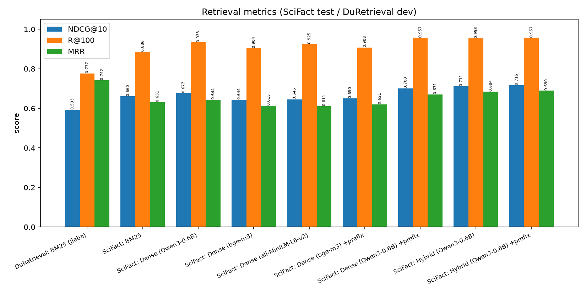
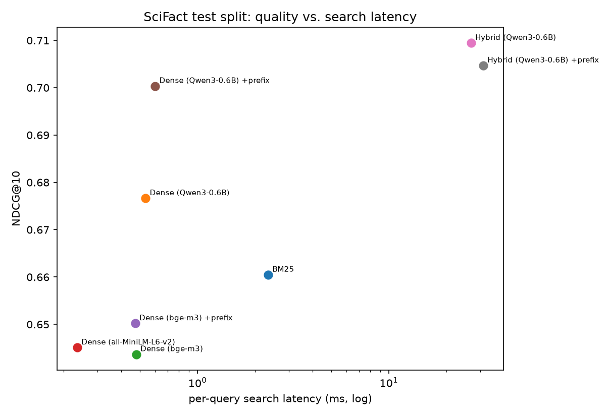
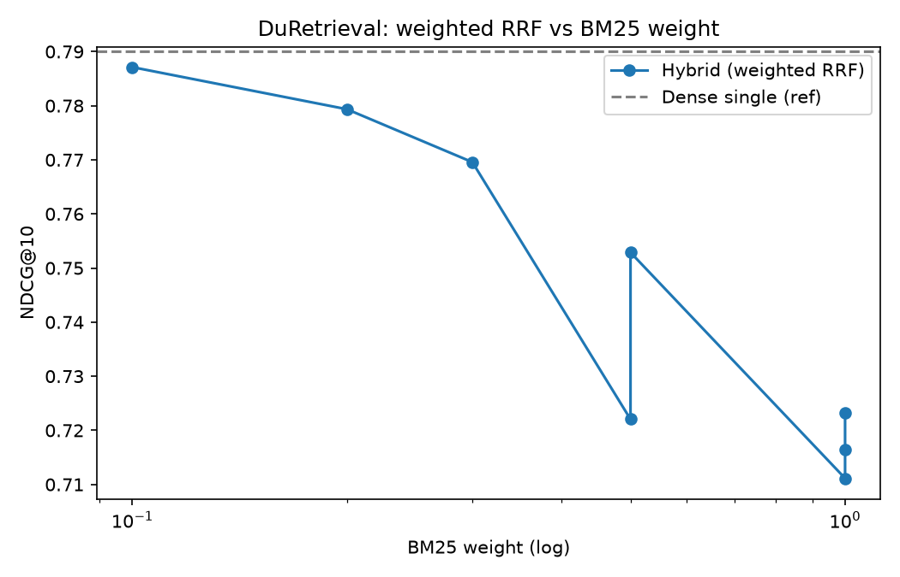
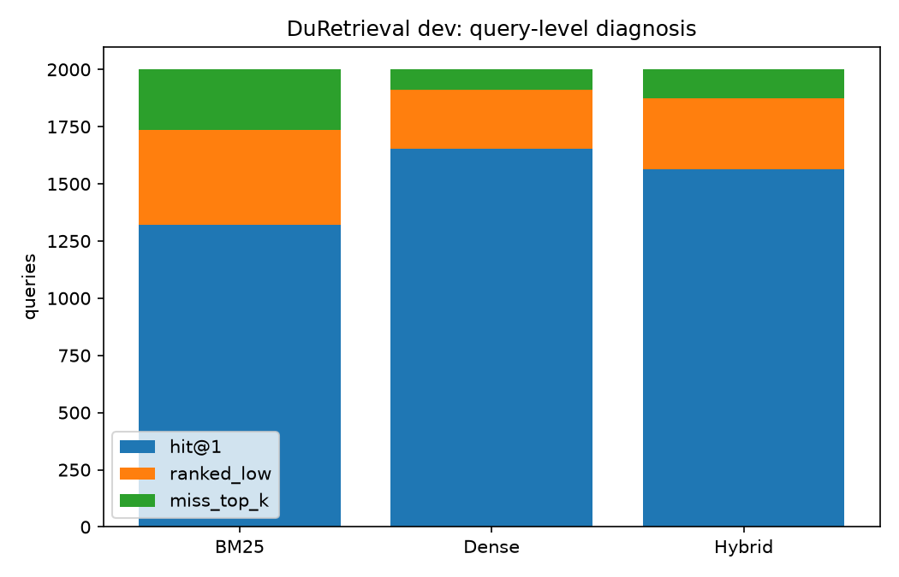

# TextMind：中文与英文文本检索算法实验报告

> 课程大作业实验报告 · 2026-11
> 仓库：https://github.com/AlbertQ430/TextMind

## 摘要

本项目构建了一个最小可复现的文本检索实验闭环，在同一数据集与统一评价口径下比较三种检索方法：BM25 关键词检索、Dense Retrieval（Embedding 编码 + 余弦相似度）与 Hybrid Retrieval（RRF 融合）。实验在英文 SciFact（300 条 test query）与中文 DuRetrieval（C-MTEB 子集，2,000 条 dev query）上进行，评价指标包括 P@K、R@K、MRR 与 NDCG@K，并分别记录语料编码、查询编码与向量检索耗时。结果表明：Dense 明显优于 BM25；模型官方查询前缀能显著提升效果；Hybrid 的收益依赖两路检索器信号强度接近，在 BM25 明显较弱时等权 RRF 反而稀释 Dense 排序，加权 RRF 可缓解但不能完全消除该损失。项目代码、实验配置、结果 JSON 与图表均已入库，可通过固定命令复现。

## 1 引言

信息检索（IR）的目标是从大规模文档集合中找出与查询最相关的文档。两类主流方法分别是基于词频统计的 **BM25** 与基于语义向量的 **Dense Retrieval**；将两者结果融合的 **Hybrid Retrieval** 在近年检索系统中被广泛使用。

本项目不追求完整的知识管理产品，而是一个课程实验项目，回答一个具体问题：**在相同数据集和查询条件下，不同检索算法与 Embedding 模型的检索效果和运行表现有什么差异？**

## 2 研究问题

- **RQ1**：BM25 与 Dense Retrieval 在同一数据集上的效果差距有多大？
- **RQ2**：不同 Embedding 模型（Qwen3-Embedding-0.6B、BGE-M3、all-MiniLM-L6-v2、bge-small-zh-v1.5）表现如何？
- **RQ3**：模型官方推荐的查询前缀对检索效果的影响？
- **RQ4**：Hybrid（RRF 融合）在什么条件下优于单路检索？加权 RRF 能否改善？
- **RQ5**：错误主要来自排序还是召回？错误类型有哪些特征？

## 3 数据集

### 3.1 SciFact（英文流程验证）

BEIR 中的科学事实核查检索数据集：Corpus 5,183 篇、官方 test 查询 300 条、qrels 二值标注（约 1.13 篇/query）。许可证 CC-BY-SA-4.0。用于快速验证完整实验闭环。

### 3.2 DuRetrieval（中文正式数据集）

百度 DuReader-Retrieval 的 C-MTEB 子集（官方仓库声明 Apache-2.0）。实际下载并校验的规模：**Corpus 100,001 条、Queries 2,000 条、Qrels 9,839 条（dev split，全部二值）**，平均 4.92 篇相关文档/query，引用完整性校验通过。数据文件不纳入版本库，下载 commit 记录于 `docs/datasets.md`。

## 4 方法

### 4.1 BM25

对查询中每个不重复词项累加：

$$
\text{score}(D,Q)=\sum_{q_i\in Q}\text{idf}(q_i)\frac{f(q_i,D)(k_1+1)}{f(q_i,D)+k_1(1-b+b\cdot|D|/\text{avgdl})}
$$

其中 $\text{idf}(q)=\ln\frac{N-df(q)+0.5}{df(q)+0.5}+1$，参数取 $k_1=1.2,\ b=0.75$。中文使用 jieba 分词，英文使用小写字母数字切分。

### 4.2 Dense Retrieval

使用 SentenceTransformer 加载 Embedding 模型，对文档与查询分别编码为向量并做 L2 归一化，以余弦相似度（内积）检索 Top-K。文档向量按「模型名 + revision + 语料指纹」缓存，支持查询向量缓存与缓存失效校验。

### 4.3 Hybrid 与加权 RRF

Reciprocal Rank Fusion：

$$
\text{score}(d)=\sum_{i}\frac{w_i}{k+\text{rank}_i(d)}
$$

默认 $k=60$、等权 $w_i=1$；实验中还扫描了 BM25 权重 $w_{\text{bm25}}\in\{0.1,0.2,0.3,0.5\}$。融合只使用排名，不需要归一化不同检索器的原始分数。

## 5 实验设置

- **指标**：P@K、R@K、MRR、NDCG@K（K ∈ {1, 5, 10, 100}），宏平均；无相关标注的 query 跳过并计数（本实验未出现）。
- **耗时拆分**：数据集加载、模型加载、文档缓存加载、语料编码、查询缓存加载、查询编码、向量检索；检索均值口径为单条查询端到端检索耗时（不含查询编码）。
- **可复现性**：固定数据集下载 commit；结果 JSON 记录模型名、revision、设备、参数与耗时；实验命令与数据说明见 README。
- **硬件/环境**：Apple M5，PyTorch 2.15.0，sentence-transformers 6.3.0，MPS 推理。

## 6 实验结果

### 6.1 SciFact（英文，300 queries）

| 方法 | P@1 | NDCG@10 | R@100 | MRR |
| --- | --- | --- | --- | --- |
| BM25（k1=1.2, b=0.75） | 0.5333 | 0.6605 | 0.8859 | 0.6312 |
| Dense：Qwen3-Embedding-0.6B（无前缀） | 0.5500 | 0.6766 | 0.9333 | 0.6439 |
| Dense：Qwen3-Embedding-0.6B + 自定义前缀 | 0.5733 | 0.7003 | 0.9567 | 0.6708 |
| Dense：all-MiniLM-L6-v2 | 0.5033 | 0.6451 | 0.9250 | 0.6110 |
| Dense：BGE-M3（无前缀） | 0.5100 | 0.6437 | 0.9037 | 0.6131 |
| Dense：BGE-M3 + 自定义前缀 | 0.5300 | 0.6502 | 0.9077 | 0.6206 |
| Hybrid：BM25 + Qwen3-Embedding-0.6B（RRF） | 0.5933 | 0.7111 | 0.9533 | 0.6842 |
| Hybrid + 自定义前缀（RRF） | 0.6033 | 0.7165 | 0.9567 | 0.6896 |
| Hybrid + 自定义前缀（RRF，BM25 权重 0.5） | 0.6033 | 0.7220 | 0.9700 | 0.6939 |

### 6.2 DuRetrieval（中文，2,000 dev queries）

| 方法 | P@1 | NDCG@10 | R@100 | MRR |
| --- | --- | --- | --- | --- |
| BM25（jieba） | 0.6610 | 0.5931 | 0.7769 | 0.7420 |
| Dense：bge-small-zh-v1.5 + 前缀 | 0.8260 | 0.7900 | 0.9395 | 0.8787 |
| Hybrid：BM25 + bge-small-zh（RRF，等权） | 0.7825 | 0.7233 | 0.9338 | 0.8431 |
| Hybrid（RRF，BM25 权重 0.5） | 0.8010 | 0.7529 | 0.9422 | 0.8573 |
| Hybrid（RRF，BM25 权重 0.3） | 0.8080 | 0.7696 | 0.9395 | 0.8647 |
| Hybrid（RRF，BM25 权重 0.2） | 0.8100 | 0.7794 | 0.9395 | 0.8678 |
| Hybrid（RRF，BM25 权重 0.1） | 0.8145 | 0.7871 | 0.9395 | 0.8716 |

### 6.3 加权 RRF 参数探索

在 DuRetrieval dev split 上，BM25 权重 0.1 为当前搜索范围内的最佳配置（NDCG@10 = 0.7871），仍略低于 Dense 单路（0.7900）。该结果是开发集调参，不代表独立测试集上的泛化表现。

## 7 错误分析

对 DuRetrieval dev 的 2,000 条 query 做 Top-1 / Top-10 诊断：

| 方法 | Top-1 命中 | Top-10 内有相关但非 Top-1 | Top-10 无相关 |
| --- | --- | --- | --- |
| BM25 | 66.1% | 20.8% | 13.2% |
| Dense | 82.6% | 13.1% | 4.3% |
| Hybrid | 78.2% | 15.5% | 6.2% |

- **排序损失为主**：Dense 的 `ranked_low` 占 13.1%，相关文档在 Top-10 内但被语义近似、主题不同的同类文档挤到后面（如拆机类问题混淆不同型号）。
- **召回失败集中在术语歧义与领域漂移**：如游戏术语「eve 回电」、口语化「360wifi 密码错误」等。
- **Hybrid 相对 Dense**：Top-1 收益 79 条、损失 166 条（净 −87），等权 RRF 在 BM25 较弱时不占优。

> 案例按 query 顺序抽取，仅作定性说明；完整案例见 `docs/error-analysis.md`。

## 8 讨论

1. **前缀影响**：Qwen3-Embedding 加官方 instruct 前缀后 NDCG@10 提升 +0.0243（SciFact）、+0.0241（DuRetrieval）；BGE-M3 官方前缀提升 +0.0065。说明对推荐使用指令前缀的模型，应按官方用法配置。
2. **Hybrid 的适用条件**：RRF 融合的收益依赖两路检索器信号强度接近。SciFact 上 BM25 与 Dense 差距较小，Hybrid 优于单路；DuRetrieval 上 BM25 明显弱于 Dense，等权融合稀释 Dense 信号，加权 RRF 可缓解（0.7233 → 0.7871）但无法超过 Dense 单路——RRF 只保留排名、丢失分数间隔信息。
3. **模型选择**：中文场景下 bge-small-zh-v1.5（24M）在 DuRetrieval 上以约 1/6 的编码成本（6.8 min vs Qwen3 约 3 小时）取得 0.7900 的 NDCG@10；BGE-M3 在 MPS 上批量编码会 OOM，未采用。
4. **局限**：当前 DuRetrieval 结果均基于 dev split，正式结论需在留出测试集上复核；SciFact 仅为英文流程验证，规模较小。

## 9 结论与未来工作

项目完成了从数据加载、BM25/Dense/Hybrid 检索、评价指标、缓存与可复现性到错误分析和图表的完整闭环。核心结论：Dense 优于 BM25；官方查询前缀值得配置；Hybrid 需要根据子路质量调整权重；错误以排序校准与术语歧义为主。

未来工作：

1. 在留出测试集上复核加权 RRF 与模型对比结论；
2. 实验 Reranker（如 bge-reranker）与更多中文 Embedding 模型；
3. 引入查询改写、同义词扩展以缓解术语歧义；
4. 补充 k1/b 参数扫描与置信区间，完善统计严谨性。

## 参考文献

1. S. Robertson, H. Zaragoza. The Probabilistic Relevance Framework: BM25 and Beyond. Foundations and Trends in IR, 2009.
2. G. V. Cormack, C. L. A. Clarke, S. Büttcher. Reciprocal Rank Fusion Outperforms Condorcet and Individual Rank Learning Methods. SIGIR, 2009.
3. N. Thakur, N. Reimers, A. Rücklé, A. Srivastava, I. Gurevych. BEIR: A Heterogeneous Benchmark for Zero-shot Evaluation of Information Retrieval Models. NeurIPS Datasets and Benchmarks, 2021.
4. X. Qiu et al. DuReader_retrieval: A Large-scale Chinese Benchmark for Passage Retrieval from Web Search Engine. arXiv:2203.10232, 2022.
5. Qwen Team. Qwen3-Embedding Technical Report, 2025.
6. BAAI. BGE-M3 / bge-small-zh-v1.5 Model Cards, Hugging Face.
