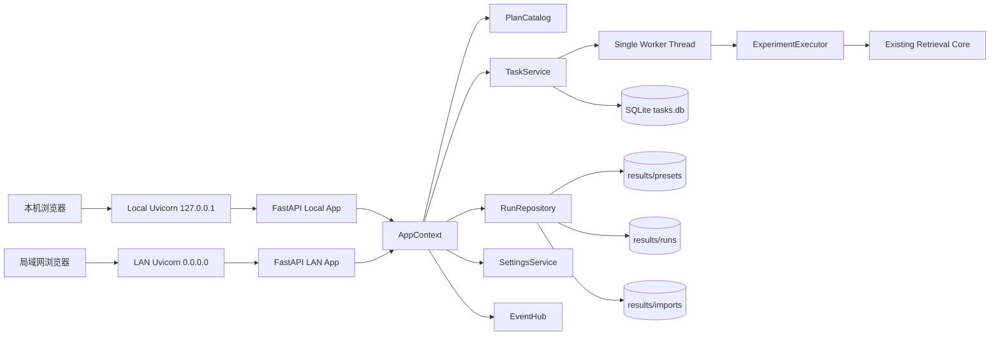
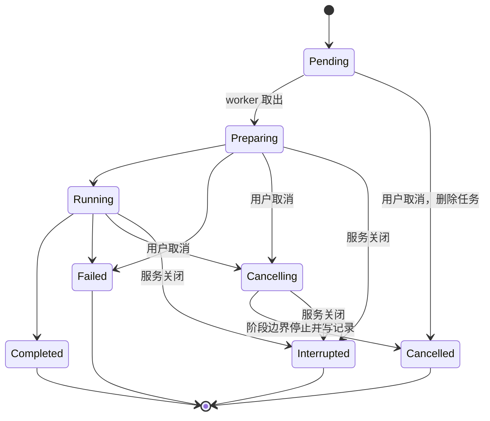

# TextMind 软件设计说明书（SDS）

> 文档状态：评审通过版 v0.1
>
> 编制日期：2026-11-21
>
> 批准日期：2026-11-21
>
> 需求基线：[SRS v0.2](../requirements/SRS.md)
>
> 适用范围：TextMind 实验演示型 MVP（A 阶段）

## 1. 设计目标与约束

### 1.1 设计目标

SDS 将冻结的 SRS v0.2 转换为可实施的软件结构，重点解决：

- 复用现有 Python 检索、评价和缓存实现。
- 以单变体任务组织实验执行、取消、失败和结果记录。
- 在本地 Web 环境中可靠管理单任务队列和多个浏览器客户端。
- 使用文件系统保存可导入、可比较的单次实验结果。
- 在没有 Node.js、数据库服务器和云服务的前提下完成 MVP 交付。
- 默认只开放本机访问，按需开启受访问码保护的局域网监听。

### 1.2 不改变的需求边界

本设计不增加以下能力：

- 自由组合算法、模型或参数。
- 查询级检索结果和错误分析展示。
- 多任务并行、任务优先级、断点续跑或自动重试。
- 云端部署、公网访问、账号体系或多用户权限模型。
- 自动下载、扫描或整理数据集与模型。
- 应用内删除结果记录或导出已导入记录。

### 1.3 已验证环境

初始开发环境为：

| 项目 | 值 |
| --- | --- |
| Python | 3.11.18 |
| PyTorch | 2.15.0 |
| transformers | 5.23.0 |
| sentence-transformers | 6.3.0 |
| numpy | 2.4.6 |
| matplotlib | 3.11.2 |
| jieba | 0.42.1 |
| 操作系统 | macOS Apple Silicon |

Web 依赖及最终锁定版本需在依赖安装验证后写入 `requirements.lock`，不得直接复用当前全局环境作为交付环境。

## 2. 技术选型

| 设计项 | 选择 | 理由 |
| --- | --- | --- |
| 后端 | Python 3.11 + FastAPI + Uvicorn | 与现有 Python 核心一致，提供 REST API、文件上传和 SSE，可由单进程运行 |
| 模板 | Jinja2 | 页面结构固定，服务端渲染可以减少前端状态和构建工具 |
| 前端 | 原生 JavaScript + CSS | MVP 不引入 Node.js 或 SPA 框架，降低安装和维护成本 |
| 任务状态 | SQLite 3 | Python 标准库可用，适合单实例持久状态、单任务队列和异常恢复 |
| 运行结果 | JSON + 同目录图表文件 | 易于查看、复制和导入，不依赖数据库 |
| 方案配置 | JSON + JSON Schema | 无额外解析依赖，可校验和版本化 |
| 实时更新 | Server-Sent Events（SSE） | 状态单向推送足够，较 WebSocket 简单，断线后由浏览器重连 |
| 对比图 | matplotlib 按需生成 PNG | 复用现有绘图能力，不在运行 JSON 中写入跨记录图表 |
| 进程模型 | 单应用进程 + 单工作线程 | 满足单任务执行，同时保持 Web 请求响应 |
| 局域网 | 同进程第二 Uvicorn 监听器 | 共用任务服务和结果状态，不启动第二套调度器 |

不引入 Node.js、Electron、容器、Redis、Celery、外部数据库或前端构建流水线。

## 3. 总体架构

### 3.1 运行拓扑



默认只启动 Local Uvicorn。局域网启用后，在同一 Python 进程内启动第二个 Uvicorn App，监听独立的局域网端口。两个 App 共用同一个 `AppContext`、任务队列、SQLite 状态和结果目录；LAN App 不创建第二个任务调度器。

### 3.2 分层

| 层 | 职责 |
| --- | --- |
| Web 层 | HTTP 路由、模板、SSE、上传、访问范围校验、CSRF |
| 应用层 | 方案查询、任务提交与取消、实验执行、结果导入、比较 |
| 领域层 | 方案、变体、任务状态、阶段、运行记录 |
| 检索核心 | 数据集、BM25、Dense、Hybrid、指标和缓存 |
| 基础设施层 | SQLite、JSON 文件、目录、环境检查、日志、LAN 监听器 |

Web 层不得直接调用检索器，也不得直接拼接结果文件路径。所有文件访问通过应用服务完成。

## 4. 代码结构

保留现有检索核心，新增应用与 Web 模块：

```text
src/
  document/                  # 现有数据模型与加载器
  evaluation/                # 现有指标
  retrieval/                 # 现有 BM25 / Dense / Hybrid
  experiment/
    plans.py                 # 方案和变体模型、加载、校验
    executor.py              # 单变体执行与阶段回调
    environment.py           # 运行环境采集
    charts.py                # 单运行图表和比较图
  tasks/
    models.py                # 任务状态和阶段模型
    repository.py            # SQLite 持久化
    service.py               # 单任务队列和工作线程
  records/
    schema.py                # 运行记录模型和兼容校验
    repository.py            # 三类结果目录扫描与读写
    importer.py              # JSON 和图表导入
    compare.py               # 同方案版本比较
  web/
    app.py                   # App 工厂和 lifespan
    context.py               # AppContext
    routes/
    security.py
    sse.py
    templates/
    static/
  paths.py                   # 项目路径和目录边界
config/
  plans.json
  settings.example.json
schemas/
  plan_catalog.schema.json
  run_record.schema.json
results/
  presets/
  runs/
  imports/
scripts/
  install.py
  check_env.py
  start.py
  build_presets.py
tests/
```

现有 `src/scripts/run_experiment.py` 保留为 CLI 适配器，但实验主体迁移到可复用的 `ExperimentExecutor`，由 CLI 与 Web 共用。

## 5. 方案与变体模型

### 5.1 方案目录

`config/plans.json` 是唯一运行时方案来源。SRS §2.4 中的 3 个方案、`v1` 版本和 17 个唯一变体必须逐项写入该文件。

DuRetrieval 方案的 `dataset.split` 固定为 `dev`；方案详情、运行记录和历史比较必须保留并显示该划分，不得表述为独立测试集结果。

方案对象至少包含：

| 字段 | 说明 |
| --- | --- |
| `schema_version` | 方案配置格式版本 |
| `plan_id` | 稳定方案 ID |
| `plan_version` | 稳定方案版本 |
| `name` | 展示名称 |
| `description` | 实验目的 |
| `dataset` | 数据集标识、语言、划分和运行时资源类型 |
| `evaluation` | `top_k` 和 `k_values` |
| `variants` | 可运行变体和只读参照项 |
| `preset` | 预置结果 ID 和构建来源 |

变体对象按方法带条件字段：

| 字段 | BM25 | Dense | Hybrid |
| --- | --- | --- | --- |
| `variant_id` | 必需 | 必需 | 必需 |
| `name` | 必需 | 必需 | 必需 |
| `kind` | `run` | `run` | `run` / `reference` |
| `method` | `bm25` | `dense` | `hybrid` |
| `k1` / `b` | 必需 | 不适用 | 必需 |
| `tokenizer` | 必需 | 不适用 | 必需 |
| `model` | 不适用 | 必需 | Dense 子路必需 |
| `model.directory_name` | 不适用 | 必需 | 必需 |
| `model.revision` | 不适用 | 预置记录必需 | 预置记录必需 |
| `query_prefix` | 不适用 | 必需，可为空 | Dense 子路必需，可为空 |
| `rrf_k` / `rrf_weights` | 不适用 | 不适用 | 必需 |
| `preset_run_id` | 必需 | 必需 | 可运行变体必需 |

### 5.2 配置加载与校验

应用启动时加载一次 `plans.json`，校验失败属于核心配置错误，应阻止服务启动。校验包括：

- 方案 ID 与版本组合唯一。
- 每个方案内变体 ID 唯一。
- SRS 冻结的 17 个唯一变体和 3 个方案全部存在。
- `top_k >= max(k_values)`。
- BM25 参数和 RRF 权重合法。
- Dense 模型目录名和查询前缀字段完整。
- 参照结果指向存在的同 ID 预置结果。
- 预置运行 ID 在目标目录存在且可读取。
- 不包含超出 SRS 范围的自由配置入口。

配置格式使用 `schemas/plan_catalog.schema.json` 校验，再由 Pydantic 模型执行跨字段校验。

### 5.3 预置结果构建

`scripts/build_presets.py` 将现有 `data/evaluation/` 原始结果转换为正式运行记录：

1. 按 `config/plans.json` 的 `preset.source_path` 找到原始 JSON。
2. 校验原始配置与方案配置一致。
3. 生成稳定 `preset_run_id`、`plan_id`、`plan_version`、`variant_id` 和 `format_version`。
4. 保留原始指标、耗时、运行时间与环境。
5. 生成单运行图表。
6. 用成功生成的图表清单组装最终记录。
7. 原子写入 `results/presets/<run_id>/run.json`。
8. 输出缺失、重复或映射不一致清单。

原始结果仍是历史实验资料；构建过程不修改原始 JSON。重复的 SciFact BM25 运行不在预置方案中重复使用。

预置运行记录、图表和 SciFact 数据随软件提供。打开预置运行记录不得解析数据集或加载 Embedding 模型，因此用户没有准备 DuRetrieval 和模型文件时仍可查看全部预置结果。

## 6. 运行记录设计

### 6.1 目录布局

```text
results/
  presets/
    <run_id>/
      run.json
      charts/
        metrics.png
        timing.png
  runs/
    <run_id>/
      run.json
      charts/
  imports/
    <run_id>/
      run.json
      charts/
```

结果来源完全由顶层目录决定，JSON 不保存来源或导入时间。导入过程保持 `run.json` 内容不变。

随包提供 `results/README.md`，说明三类目录、JSON 与图表关系、运行目录移动/删除后果，以及应用内不提供删除和恢复功能。

### 6.2 记录字段

运行记录格式版本初始为 `1.0`，顶层包含：

| 字段 | 必需 | 说明 |
| --- | --- | --- |
| `format_version` | 是 | 运行记录格式版本 |
| `run_id` | 是 | 全局唯一运行 ID |
| `plan_id` / `plan_version` | 是 | 所属方案与版本 |
| `variant_id` | 是 | 所属实验变体 |
| `plan_name` / `variant_name` | 是 | 便于只读展示的名称快照 |
| `status` | 是 | `Completed`、`Failed`、`Cancelled` 或 `Interrupted` |
| `stage_progress` | 是 | 已完成阶段、发生终止时所在阶段和不适用阶段 |
| `started_at` / `finished_at` | 是 | UTC ISO 8601 时间 |
| `cancelled_at` | 条件 | 取消时间 |
| `dataset` | 是 | 标识、划分、规模、查询数和 qrels 对数 |
| `variant_config` | 是 | 算法、模型、前缀、参数和评价设置 |
| `metrics` | 条件 | 完成的指标结果 |
| `num_queries` / `num_skipped` | 条件 | 评价覆盖信息 |
| `timing` | 是 | 按 §8.5 固定口径保存分阶段耗时 |
| `environment` | 是 | 运行环境；导入记录可为空 |
| `charts` | 是 | 最终成功可用的图表数组，每项含 `id`、`title` 和相对 `path`；不得写入尚未生成的预期图表 |
| `error` | 条件 | 失败摘要、技术详情和失败阶段 |

`metrics` 不完整时不得伪造缺失值。失败、取消或中断记录可以省略 `metrics`，但必须包含状态和已有阶段信息。

示意记录：

```json
{
  "format_version": "1.0",
  "run_id": "20261121T081500123456Z-a1b2c3",
  "plan_id": "scifact-comparison",
  "plan_version": "v1",
  "variant_id": "scifact-bm25",
  "plan_name": "SciFact 英文检索方法与模型对比",
  "variant_name": "BM25",
  "status": "Completed",
  "stage_progress": {
    "completed": [
      "prepare",
      "load_dataset",
      "build_index",
      "retrieve",
      "evaluate",
      "generate_charts",
      "assemble_final_record",
      "write_record"
    ],
    "current": null,
    "not_applicable": ["load_model", "encode_queries"]
  },
  "started_at": "2026-11-21T08:15:00.123456Z",
  "finished_at": "2026-11-21T08:15:02.000000Z",
  "dataset": {
    "name": "scifact",
    "split": "test",
    "corpus_size": 5183,
    "query_count": 300
  },
  "variant_config": {
    "method": "bm25",
    "k1": 1.2,
    "b": 0.75,
    "tokenizer": "simple",
    "top_k": 100,
    "k_values": [1, 5, 10, 100]
  },
  "metrics": {
    "P@1": 0.5333,
    "NDCG@10": 0.6605,
    "R@100": 0.8859,
    "MRR": 0.6312
  },
  "num_queries": 300,
  "num_skipped": 0,
  "timing": {
    "dataset_load_seconds": 0.1,
    "model_load_seconds": null,
    "index_build_seconds": 0.2,
    "doc_cache_load_seconds": null,
    "corpus_encode_seconds": null,
    "query_cache_load_seconds": null,
    "query_encode_seconds": null,
    "bm25_search_total_seconds": 0.69,
    "dense_search_total_seconds": null,
    "rrf_fusion_seconds": null,
    "retrieval_total_seconds": 0.69,
    "retrieval_mean_seconds": 0.0023,
    "retrieval_median_seconds": 0.0022
  },
  "environment": {
    "python": "3.11.18",
    "platform": "macOS",
    "device": "cpu"
  },
  "charts": [
    {
      "id": "metrics",
      "title": "指标",
      "path": "charts/metrics.png"
    }
  ],
  "error": null
}
```

### 6.3 写入规则

- 使用 `run.json.tmp` 写入、`fsync` 后通过 `os.replace` 原子替换。
- 记录只写入终态；运行中的任务状态以 SQLite 为准。
- 正常完成时必须先生成图表，再组装最终记录，最后写入 JSON。
- 图表先写入同目录临时文件，再原子改名；只有成功改名并验证可读的图表才加入 `charts`。
- 图表生成失败不阻止完成状态，对应错误写入应用日志，失败图表不加入 `charts`。
- 不得在图表生成前写入带有预期图表列表的完成记录。
- 运行目录必须在 `results/runs` 内创建，不接受外部路径。
- 运行 ID 只允许 `A-Z`、`a-z`、`0-9`、`.`、`_`、`-`，并拒绝 `.` 与 `..`。
- 失败或取消时尽量保存已完成的阶段和已有指标；写出记录失败本身应记录为系统错误。

### 6.4 兼容与迁移

- 当前 `data/evaluation/` JSON 不是正式运行记录，不能直接导入。
- `build_presets.py` 将其转换为 `format_version=1.0` 的预置记录。
- 读取时按主版本兼容；遇到不兼容版本拒绝加载或导入。
- 导入记录保持原文件内容，不因当前应用版本而回写字段。

## 7. 任务管理

### 7.1 任务粒度

一次任务只包含一个 `plan_id + plan_version + variant_id`。用户选择一个变体提交后，Run ID 立即生成；任务与运行记录共用该 ID，减少额外标识。

Run ID 格式建议：

```text
YYYYMMDDTHHMMSSffffffZ-<6 位随机标识>
```

预置结果使用稳定的 `preset-` 前缀 ID。

### 7.2 状态机



补充规则：

- `Pending` 取消后删除任务行，不生成运行记录。
- `Cancelling` 不抢占当前不可中断操作，只设置取消事件。
- 等待任务不跨服务关闭或重启保留。
- 服务启动时删除旧 `Pending`；对旧 `Preparing`、`Running`、`Cancelling` 先检查是否存在合法终态记录，再按 §7.7 恢复状态或生成最小 `Interrupted` 记录。
- 失败、取消和中断均不显示为正常完成。
- 失败变体不自动重试；用户重新提交时由服务端分配新的 Run ID，原失败记录保持不变。

### 7.3 SQLite 表

初始表结构：

```sql
CREATE TABLE tasks (
    run_id TEXT PRIMARY KEY,
    plan_id TEXT NOT NULL,
    plan_version TEXT NOT NULL,
    variant_id TEXT NOT NULL,
    status TEXT NOT NULL,
    current_stage TEXT,
    completed_stages_json TEXT NOT NULL DEFAULT '[]',
    submitted_at TEXT NOT NULL,
    started_at TEXT,
    ended_at TEXT,
    cancel_requested INTEGER NOT NULL DEFAULT 0,
    config_snapshot_json TEXT NOT NULL,
    error_summary TEXT
);

CREATE INDEX idx_tasks_status_submitted
ON tasks(status, submitted_at);

CREATE TABLE notices (
    id INTEGER PRIMARY KEY AUTOINCREMENT,
    kind TEXT NOT NULL,
    count INTEGER NOT NULL CHECK (count > 0),
    created_at TEXT NOT NULL
);
```

`notices` 只保存必须跨进程展示的最小状态，不扩展为通用通知中心：

- `kind` 取 `queue_cancelled_on_shutdown` 或 `queue_cancelled_on_restart`。
- `count` 保存被取消的等待任务数量。
- 删除 `Pending` 任务和插入提示必须在同一个 SQLite 事务中完成。
- 提示确认后直接删除对应行；未确认提示跨浏览器刷新和进程重启保留。

数据库文件位于 `data/app/textmind.db`，启用 WAL。所有写事务显式提交，状态更新后再向 SSE 广播。

### 7.4 单工作线程

- `TaskService` 启动一个 daemon 工作线程。
- 队列顺序使用任务提交时间与 SQLite 行顺序，不提供优先级。
- 同一时间只取出一个 `Pending` 任务。
- 浏览器请求只负责提交、取消和读取状态，不执行实验。
- 多客户端共享同一 `TaskService` 和同一个工作线程。
- 浏览器刷新、关闭、SSE 断线或客户端网络断开只影响该客户端连接，不触发任务取消，也不移除等待任务。
- 应用使用项目级文件锁防止同时启动两个实例，避免两个调度器共享同一结果目录。

### 7.5 阶段边界取消

任务生命周期阶段和实验结果计时项不是同一层概念。阶段用于运行监控和取消检查，不能直接把相邻阶段的墙钟时间差当作 SRS 规定的实验耗时。

任务执行阶段：

1. `prepare`
2. `load_dataset`
3. `load_model`
4. `build_index`
5. `encode_queries`
6. `retrieve`
7. `evaluate`
8. `generate_charts`
9. `assemble_final_record`
10. `write_record`

BM25 跳过 `load_model` 和 `encode_queries`；Dense 跳过 `retrieve` 以外的 BM25 子阶段；Hybrid 包含适用的全部阶段。界面应将不适用阶段标记为“不适用”，不得标成“待执行”。

阶段与计时项的关系：

| 生命周期阶段 | 可能产生的计时项 |
| --- | --- |
| `prepare` | 不计入实验结果耗时；仅记录任务时间戳 |
| `load_dataset` | `dataset_load_seconds` |
| `load_model` | `model_load_seconds` |
| `build_index` | `index_build_seconds`，并可能包含 `doc_cache_load_seconds`、`corpus_encode_seconds` |
| `encode_queries` | `query_cache_load_seconds`、`query_encode_seconds` |
| `retrieve` | `bm25_search_total_seconds`、`dense_search_total_seconds`、`rrf_fusion_seconds` 及派生检索汇总 |
| `evaluate` | `evaluation_seconds`（补充项） |
| `generate_charts` / `assemble_final_record` / `write_record` | 不计入实验检索耗时；由任务时间戳和应用日志记录 |

`index_build_seconds` 是父级耗时，文档缓存加载和语料编码是其子集，界面不得将父子项再次相加。

工作线程在每个阶段开始前、结束后检查取消事件。不可中断阶段完成后立即执行下一步检查，不再进入后续阶段。取消等待时间取决于当前阶段，界面必须提示这一点。

正常完成路径的顺序固定为：

```text
evaluate
  -> generate_charts
  -> assemble_final_record
  -> write_record
  -> Completed
```

`generate_charts` 只负责生成可用图片文件，并返回成功图表清单；`assemble_final_record` 根据实际成功清单组装 JSON；`write_record` 原子写入最终记录。取消、失败或中断路径不要求先生成图表，由任务管理层组装可获得的终态记录并写入。

### 7.6 正常关闭与异常退出

正常关闭顺序：

1. 设置 `accepting=False`，拒绝新提交。
2. 在同一事务中统计并删除全部 `Pending` 任务；数量大于 0 时插入 `queue_cancelled_on_shutdown` 提示。
3. 为当前任务设置关闭事件、撤销工作线程的最终发布令牌并记录中断原因；暂不提交 SQLite 终态。
4. 按 §7.7 的顺序发布中断记录或最小中断信息，再提交 SQLite 终态。
5. 停止 LAN 监听器和 Local 服务器。

异常退出后的启动顺序：

1. 获取实例文件锁。
2. 打开 SQLite，在同一事务中统计并删除遗留 `Pending` 行；数量大于 0 时插入 `queue_cancelled_on_restart` 提示。
3. 找出遗留的 `Preparing`、`Running`、`Cancelling` 任务。
4. 对没有合法终态 JSON 的任务，按 §7.7.4 生成最小中断记录，并按 §7.7.1 先发布目录、后更新 SQLite。
5. 按 §7.7.3 对齐其余任务和记录。
6. 恢复接受任务。

正常关闭已经成功写入并删除全部 `Pending` 时，下次启动不会再次生成重复提示。若进程在正常清理前异常退出，启动恢复流程会生成 `queue_cancelled_on_restart` 提示。提示的读取和确认流程见 §10 和 §11。

### 7.7 SQLite 与 JSON 一致性

两份存储的职责严格分离：

- SQLite `tasks` 是运行中、等待中和尚未完成终态提交的任务状态源。
- `results/runs/<run_id>/run.json` 是已经发布终态结果的唯一事实源。
- 同一 `run_id` 只能有一个最终运行目录；暂存目录和最终目录不得同时被视为有效记录。
- `presets` 和 `imports` 记录没有对应任务行，不参与任务状态恢复。

#### 7.7.1 终态提交顺序

所有正常完成、失败、取消和中断记录都按以下顺序发布：

1. 在 `results/runs/.staging/<run_id>-<attempt_id>/` 创建本次发布独占的完整暂存目录。
2. 在暂存目录写入可用图表。
3. 组装终态 `run.json`，写入暂存目录。
4. 校验 `run.json` 符合 Schema，且 `charts` 中每个路径都存在并位于暂存目录内。
5. 将整个暂存目录原子重命名为 `results/runs/<run_id>/`。
6. 在 SQLite 单事务中把任务更新为同一终态，写入 `ended_at` 并清理运行中标记。
7. 向 SSE 广播终态。

必须先完成第 5 步，才能执行第 6 步。SQLite 不得在规范 `run.json` 发布前标记为 `Completed`、`Failed`、`Cancelled` 或 `Interrupted`。

发布前若目标目录已存在，必须停止当前发布并进入 §7.7.3 的对齐流程；合法记录不得覆盖，非法目标目录也不得被静默替换。

每个运行只允许持有有效发布令牌的执行者提交终态。正常关闭、异常恢复或任务管理层接管发布时，旧工作线程的令牌必须失效；旧线程恢复执行后只能退出，不得再次写 `run.json` 或覆盖 SQLite 终态。

同一进程内使用按 `run_id` 加锁的终态发布互斥器。工作线程和管理层都不能在该锁之外执行最终目录重命名或 SQLite 终态提交。暂存目录使用独立 `attempt_id`，避免工作线程仍在生成图表时，管理层已开始写入中断记录。

#### 7.7.2 失败处理

| 失败位置 | 处理 |
| --- | --- |
| 暂存文件或图表写入失败 | 任务保持非终态，保留可诊断错误并重试；不得提前更新 SQLite 终态 |
| 暂存 `run.json` 校验失败 | 任务保持非终态，记录存储错误并清理或保留暂存目录用于诊断 |
| 目录原子重命名失败 | 任务保持非终态，重试发布；不得改写 SQLite 终态 |
| 目录发布成功、SQLite 更新失败 | `run.json` 已是终态事实源；当前进程重试 SQLite 更新，重启后按 §7.7.3 对齐状态，不重新执行实验 |
| SQLite 已终态但规范 JSON 缺失 | 视为外部删除、迁移异常或历史不一致；不得凭空重生 `Completed` 记录，应标记结果不可用并记录异常 |

文件系统或 SQLite 持续不可写时，服务进入存储降级状态并拒绝新的实验提交。磁盘完全不可写属于无法保证记录落盘的系统故障，任务行保留错误信息供诊断。

#### 7.7.3 启动恢复

启动恢复按以下优先级处理同一 `run_id`：

1. 若规范目录存在且 `run.json` 有效，以该 JSON 的终态状态和时间对齐 SQLite。
2. 若规范 JSON 不存在，但存在 `<run_id>-<attempt_id>` 暂存目录且其中 `run.json` 有效、关联字段一致，将对应暂存目录原子发布为规范目录，再按该 JSON 对齐 SQLite。多个候选均合法时记录冲突错误，不自动挑选或覆盖。
3. 若规范 JSON 和合法暂存 JSON 均不存在，且 SQLite 任务仍为 `Preparing`、`Running` 或 `Cancelling`，按 §7.7.4 生成最小 `Interrupted` 记录。
4. 若规范 JSON 不存在，但 SQLite 已是终态，保留任务错误并标记结果不可用，不重新执行、不伪造指标。
5. 清理残缺暂存目录；完整且已发布的暂存目录不得重复使用。
6. 恢复流程可重复执行，结果必须幂等：已有合法终态记录不重写，已有终态 SQLite 行不被重复创建。

`run_id` 是唯一对齐键。恢复时不得仅依据方案、变体或启动时间猜测记录对应关系。

#### 7.7.4 最小 Interrupted 记录

任务没有终态 JSON 且启动时仍处于运行状态时，生成最小中断记录。必需字段：

| 字段 | 生成规则 |
| --- | --- |
| `format_version` | 当前记录格式版本 |
| `run_id` | 任务表中的运行 ID |
| `plan_id` / `plan_version` / `variant_id` | 任务配置快照 |
| `plan_name` / `variant_name` | 方案目录中的名称；缺失时记录原始 ID |
| `status` | `Interrupted` |
| `stage_progress` | 已完成阶段、最后阶段和不适用阶段 |
| `started_at` | 任务表开始时间；缺失时使用提交时间 |
| `finished_at` | 本次启动检测并完成中断记录的时间 |
| `dataset` | 从配置快照恢复标识与划分；未知字段留空 |
| `variant_config` | 任务提交时的完整配置快照 |
| `timing` | 可获得的已记录计时；其余字段为 `null` |
| `environment` | 已采集环境；未采集时为空对象 |
| `charts` | 已完整生成且仍存在的可用图表；无法确认完整性时为空数组 |
| `error` | `SERVICE_INTERRUPTED`、可理解摘要、最后阶段和技术详情 |

不得把未知指标填成零，不得声称中断任务已完成。最小中断记录同样走 §7.7.1 的暂存、校验、目录发布后再更新 SQLite 的流程。

## 8. 实验执行器

### 8.1 接口

```python
class ExperimentExecutor:
    def execute(
        self,
        plan: PlanDefinition,
        variant: VariantDefinition,
        run_id: str,
        report_stage: Callable[[str], None],
        cancellation: CancellationToken,
    ) -> RunRecord: ...
```

执行器负责：

- 读取数据并校验。
- 构建对应检索器。
- 使用本地模型目录加载 Embedding 模型。
- 执行检索和指标评价。
- 汇总分阶段耗时。
- 采集环境信息。
- 生成单运行图表。
- 返回待持久化的运行记录。

执行器不负责 SQLite、HTTP、页面导航或导入；这些由应用层和基础设施层负责。

### 8.2 与现有核心的复用

- 数据加载继续使用 `document.dataset.load_scifact` / `load_duretrieval`。
- BM25、Dense、Hybrid 和指标计算继续使用现有实现。
- `run_experiment.py` 的模型加载、缓存键、查询前缀、计时口径迁移到执行器。
- CLI 保留 `parse_args` 和文本输出，内部调用执行器。
- 不复制算法到 Web 代码。

### 8.3 资源与模型

- SciFact 路径由应用资源目录自动配置。
- DuRetrieval 路径来自主机设置。
- 模型路径由 `model_root / variant.model.directory_name` 计算。
- 使用 SentenceTransformer 的本地路径加载和离线模式，禁止依赖缓存下载缺失模型。
- 模型目录至少检查 `config.json`、模型权重文件和 tokenizer 可加载性。
- 资源检查按变体执行；缺失资源只使对应变体不可运行。
- 资源缺失不得影响 `results/presets` 的浏览；预置结果的读取不依赖当前数据集或模型状态。

### 8.4 环境信息

运行记录采集：

- 操作系统名称和版本。
- CPU 架构和可获得时的 CPU 型号。
- PyTorch、transformers、sentence-transformers、numpy、jieba 和 matplotlib 版本。
- 计算设备：`mps`、`cuda` 或 `cpu`。
- 适用时的 GPU 名称。

不采集主机名、用户名、设备序列号、IP 地址或模型绝对路径。当前 MPS 是否可用由运行时判断，允许回退到 CPU。

### 8.5 计时统计

执行器使用独立的 `DurationRecorder` 记录实验耗时，与 `StageReporter` 解耦。所有时间以秒为单位保存为浮点数，并遵循以下规则：

- 字段值为数字：该阶段适用并实际执行。
- 字段值为 `0.0`：该阶段适用，但缓存命中或实际耗时可忽略。
- 字段值为 `null`：该阶段对当前变体不适用。

#### 8.5.1 固定字段

| 字段 | 适用变体 | 起止位置 | 聚合规则 |
| --- | --- | --- | --- |
| `dataset_load_seconds` | 全部 | 调用数据集加载器前到校验完成后 | 单次任务总计 |
| `model_load_seconds` | Dense / Hybrid | `SentenceTransformer` 构造前到加载完成后 | 单次任务总计；Hybrid 只加载一次 |
| `index_build_seconds` | 全部 | `retriever.fit(documents)` 前到返回后 | 单次任务总计；父级字段 |
| `doc_cache_load_seconds` | Dense / Hybrid | `DenseRetriever.fit` 内加载文档缓存前到加载判断结束 | 单次任务总计 |
| `corpus_encode_seconds` | Dense / Hybrid | 文档缓存未命中，调用 `_encode(texts)` 前到返回后 | 单次任务总计；命中时为 `0.0` |
| `query_cache_load_seconds` | Dense / Hybrid | `DenseRetriever.encode_queries` 内读取查询缓存前到加载判断结束 | 单次任务总计 |
| `query_encode_seconds` | Dense / Hybrid | 查询缓存未命中，调用 `_encode(queries)` 前到返回后 | 单次任务总计；命中时为 `0.0` |
| `bm25_search_total_seconds` | BM25 / Hybrid | 每次 `BM25Retriever.search` 前到返回后 | 所有查询耗时之和 |
| `dense_search_total_seconds` | Dense / Hybrid | 每次 `DenseRetriever.search_vector` 前到返回后 | 所有查询耗时之和 |
| `rrf_fusion_seconds` | Hybrid | 每次 `HybridRetriever.rrf_fuse` 前到返回后 | 所有查询耗时之和 |
| `retrieval_total_seconds` | 全部 | 单查询检索 Start 前到该查询检索返回后 | 所有查询端到端检索耗时之和 |
| `retrieval_mean_seconds` | 全部 | 由单查询检索耗时计算 | 算术平均 |
| `retrieval_median_seconds` | 全部 | 由单查询检索耗时计算 | 中位数 |
| `evaluation_seconds` | 全部 | 调用 `evaluate` 前到返回后 | 补充项，不参与检索均值 |

#### 8.5.2 方法特定口径

**BM25**

- `index_build_seconds` 对应 `BM25Retriever.fit`。
- `bm25_search_total_seconds` 对应逐查询 `BM25Retriever.search`。
- `retrieval_*` 只由 BM25 检索耗时计算。
- 模型、文档缓存、语料编码、查询缓存和查询编码字段为 `null`。

**Dense**

- `index_build_seconds` 对应 `DenseRetriever.fit` 总耗时。
- `doc_cache_load_seconds` 和 `corpus_encode_seconds` 来自 `DenseRetriever.timing` 中的独立内部计时。
- `query_cache_load_seconds` 和 `query_encode_seconds` 分别来自 `encode_queries` 内的两个独立段。
- 查询缓存加载不计入查询编码；缓存命中时 `query_encode_seconds=0.0`。
- `dense_search_total_seconds` 对应逐向量 `search_vector`，`retrieval_*` 只由该检索耗时计算。
- `bm25_search_total_seconds` 和 `rrf_fusion_seconds` 为 `null`。

**Hybrid**

- `index_build_seconds` 对应 `HybridRetriever.fit` 总耗时，包含 BM25 建索引与 Dense 索引准备。
- 文档缓存加载和语料编码来自 Dense 子路内部计时，不重复计入查询耗时。
- 查询缓存加载与查询编码来自 Dense 子路 `encode_queries`，二者独立计时。
- `bm25_search_total_seconds`、`dense_search_total_seconds` 和 `rrf_fusion_seconds` 分别对应 `search_batch` 中的三个独立计时段。
- Hybrid 单查询端到端检索耗时：

```text
query_retrieval_i =
    bm25_search_i
  + dense_search_i
  + rrf_fusion_i
```

- 汇总必须满足：

```text
retrieval_total_seconds ≈
    bm25_search_total_seconds
  + dense_search_total_seconds
  + rrf_fusion_seconds
```

- 查询缓存加载和查询编码不计入 `retrieval_*`。

#### 8.5.3 旧结果迁移

`build_presets.py` 按下表转换旧字段，不把粗粒度阶段时间冒充精细计时：

| 旧字段 | 新口径 |
| --- | --- |
| `load_seconds` | `dataset_load_seconds` |
| `model_load_seconds` | `model_load_seconds` |
| `index_seconds` | `index_build_seconds` |
| `doc_cache_load_seconds` | 同名新字段 |
| `corpus_encode_seconds` | 同名新字段 |
| `query_cache_load_seconds` | 同名新字段 |
| `query_encode_seconds` | 同名新字段 |
| BM25 的 `vector_search_total_seconds` | `bm25_search_total_seconds` |
| Dense 的 `vector_search_total_seconds` | `dense_search_total_seconds` |
| Hybrid 的 `vector_search_total_seconds` | `retrieval_total_seconds` |
| `bm25_search_seconds` | `bm25_search_total_seconds` |
| `dense_search_seconds` | `dense_search_total_seconds` |
| `rrf_fusion_seconds` | 同名新字段 |
| `search_total_seconds` | `retrieval_total_seconds` |
| `search_mean_seconds` | `retrieval_mean_seconds` |
| `search_median_seconds` | `retrieval_median_seconds` |

旧 BM25 结果将建索引时间写入 `corpus_encode_seconds` 的做法不得沿用；迁移时以 `index_seconds` 解释为 `index_build_seconds`，BM25 的模型和编码相关字段设为 `null`。旧结果中的 `0.0` 不等于“适用且缓存命中”，不得原样复制到新字段。

#### 8.5.4 展示规则

- 结果页将数字转换为毫秒展示，同时保留秒值来源。
- `null` 显示“不适用”，不得显示为 `0 ms`。
- `0.0` 显示“缓存命中”或“0 ms”，具体标签由字段语义决定。
- 父级 `index_build_seconds` 与子项使用层级展示，不参与同一层求和。
- 单查询检索均值固定标注“不包含查询编码”。

### 8.6 图表

正常完成的单变体运行生成：

- `metrics.png`：该变体指标。
- `timing.png`：该变体适用的分阶段耗时。

图表标题和图例使用记录中的方案、变体和模型名称。单运行图表不得包含其他变体数据。

每个图表先写入 `charts/.tmp-*`，完成绘制、关闭画布并确认文件可读后原子改名为最终路径。执行器在 `generate_charts` 结束后返回成功图表清单，再由 `assemble_final_record` 将清单写入 `charts` 字段。

图表生成失败不改变已完成指标的有效性：

- 成功图表进入最终 `charts` 清单。
- 失败图表不写入 `charts`，错误详情写入应用日志。
- 缺失图表在界面显示为不可用。
- 最终 `run.json` 仍可正常写出，状态为 `Completed`。

如果 `run.json` 暂存或目录发布失败，任务保持非终态并停留在 `write_record`，错误写入任务行和应用日志；系统重试发布并拒绝新的实验提交。重启后若仍无合法终态 JSON，按 §7.7.4 生成最小中断记录。已生成但未登记的图表文件属于无效暂存目录，不得伪装成有效完成记录。

取消、失败或中断发生在图表阶段时，任务管理层可以使用已经成功生成的图表组装终态记录；未成功生成的图表不得补写为预期路径。

## 9. 设置与资源管理

### 9.1 设置文件

主机设置保存在 `data/app/settings.json`，使用临时文件加原子替换更新。初始结构：

```json
{
  "schema_version": 1,
  "model_root": null,
  "duretrieval_root": null,
  "device": "auto",
  "network": {
    "lan_enabled": false,
    "local_port": 8765,
    "lan_port": 8766
  }
}
```

设置文件不保存局域网访问码。局域网访问码仅在当前进程中存在。

### 9.2 主机权限

只有 Local App 可以：

- 修改模型根目录和 DuRetrieval 路径。
- 修改计算设备。
- 开启或关闭局域网访问。
- 导入 JSON。

LAN App 可以查看资源状态，但不能修改主机设置。

### 9.3 Python 环境检查

启动脚本执行：

1. 检查 Python 3.11。
2. 检查 FastAPI、Uvicorn、Jinja2、numpy、matplotlib、torch 等核心依赖。
3. 检查数据与模型仅在打开方案详情时按变体报告。
4. 核心依赖缺失时阻止启动；资源缺失只影响相关变体。

环境检查复用现有 `test/` 脚本的设备、模型和相似度检查逻辑。

## 10. Web 接口

### 10.1 页面

| 页面 | 路由 | 主要内容 |
| --- | --- | --- |
| 实验中心 | `/plans` | 方案列表、语言、划分、变体可用性 |
| 方案详情 | `/plans/{plan_id}` | 变体、配置、预置结果、运行按钮 |
| 运行监控 | `/monitor` | 当前任务、阶段、等待队列、取消 |
| 结果详情 | `/results/{run_id}` | 指标、图表、配置、环境 |
| 历史记录 | `/history` | 三类记录、来源目录标识、进入比较 |
| 比较 | `/compare?runs=...` | 同方案版本记录对比 |
| 设置 | `/settings` | 资源、环境、局域网 |
| 局域网登录 | `/lan/login` | 输入临时访问码 |

根路由 `/` 重定向到 `/plans`。

### 10.2 API

| 方法 | 路径 | 权限 | 作用 |
| --- | --- | --- | --- |
| `GET` | `/api/v1/plans` | Local / LAN | 方案与变体摘要 |
| `GET` | `/api/v1/plans/{plan_id}` | Local / LAN | 方案详情和资源状态 |
| `POST` | `/api/v1/tasks` | Local / LAN | 提交单个变体 |
| `GET` | `/api/v1/tasks` | Local / LAN | 当前任务和等待队列 |
| `GET` | `/api/v1/tasks/{run_id}` | Local / LAN | 单任务状态 |
| `POST` | `/api/v1/tasks/{run_id}/cancel` | Local / LAN | 取消任务 |
| `GET` | `/api/v1/events` | Local / LAN | SSE 事件流 |
| `GET` | `/api/v1/session` | Local / LAN authenticated | 获取当前会话范围和 CSRF Token |
| `GET` | `/api/v1/notices` | Local / LAN | 获取未确认的系统提示 |
| `POST` | `/api/v1/notices/{id}/ack` | Local / LAN | 确认并删除提示 |
| `GET` | `/api/v1/runs` | Local / LAN | 扫描三类目录后的历史摘要 |
| `GET` | `/api/v1/runs/{run_id}` | Local / LAN | 读取运行记录 |
| `POST` | `/api/v1/runs/compare` | Local / LAN | 指标对比与差异 |
| `POST` | `/api/v1/imports` | Local only | 单文件 JSON 导入 |
| `GET` / `PUT` | `/api/v1/settings` | Local only | 设置读取和修改 |
| `POST` | `/api/v1/network/enable` | Local only | 开启局域网监听 |
| `POST` | `/api/v1/network/disable` | Local only | 关闭局域网监听 |
| `POST` | `/lan/login` | LAN pre-auth | 提交访问码并轮换会话 |
| `POST` | `/lan/logout` | LAN authenticated | 注销会话 |

API 不提供删除运行记录的路由。记录只能由用户通过操作系统文件管理器删除整个运行目录。

提交请求只接受：

```json
{
  "plan_id": "scifact-comparison",
  "plan_version": "v1",
  "variant_id": "scifact-bm25"
}
```

不得接受客户端提交的模型路径、查询前缀、BM25 参数、RRF 权重或任意文件路径。

### 10.3 错误格式

API 错误统一返回：

```json
{
  "error": {
    "code": "RESOURCE_MISSING",
    "message": "缺少模型资源",
    "details": ["..."],
    "request_id": "..."
  }
}
```

常用状态码：

- `400`：请求语义错误。
- `401`：需要登录或会话已失效。
- `403`：主机权限或访问码不足。
- `404`：方案、任务或记录不存在。
- `409`：任务状态冲突或重复运行 ID。
- `422`：字段或方案配置不合法。
- `429`：登录失败次数过多。
- `500`：未处理的服务错误。

`GET /api/v1/notices` 返回服务端生成的提示文本和 `count`，不得包含任务配置或文件路径。客户端只有在提示成功渲染后才调用 `ack`；若浏览器在确认前关闭，提示保持未确认并在下次访问时再次返回。

### 10.4 SSE

事件类型：

- `snapshot`：连接时发送任务、队列和状态快照。
- `task.updated`：任务状态或阶段变化。
- `queue.updated`：队列变化。
- `records.changed`：运行完成、取消、失败或导入后更新历史。
- `settings.changed`：资源或网络状态变化。
- `notices.changed`：提示新增或确认后，通知其他已连接客户端刷新。
- `session.expired`：当前 Cookie 会话失效，客户端停止重连并返回登录页。

SSE 通过 `textmind_session` Cookie 鉴权，连接建立和每次心跳都检查会话权限。每 15 秒发送心跳；客户端断线后在会话仍有效时自动重连，连续失败时退化为 2 秒轮询任务接口。收到 `session.expired` 后不再自动重连。

## 11. 页面交互

### 11.1 通用布局

- 左侧固定导航，右侧独立工作区。
- 小屏幕宽度下折叠为顶部导航。
- 状态使用文字、图标和颜色共同表达。
- 表格支持横向滚动，图表保持可读尺寸。
- 所有用户可见错误提供下一步处理建议。
- 页面初始化时读取未确认提示，在右侧工作区顶部显示一条可关闭的系统提示；内容例如“服务关闭时取消了 2 个等待任务”。用户点击“知道了”后确认并移除提示。

### 11.2 实验中心

- 方案卡片展示名称、语言、划分、变体数量和可用数量。
- 方案详情展示每个变体、模型、参数、资源状态、预置结果和运行按钮。
- 不可运行变体保留展示，但禁用运行按钮并说明原因。
- 预置结果和参照结果使用文字标签区分。
- 数据集规模可在方案详情展示，不放在主卡片主要信息中。

### 11.3 运行监控

- 展示当前任务、提交时间、已运行时间、阶段状态。
- 阶段列表区分已完成、当前、待执行和不适用。
- 取消请求发出后按钮切换为“无法立即取消”说明。
- 等待队列按提交顺序展示。
- 浏览器刷新或关闭不取消任务。

### 11.4 结果与比较

- 结果详情按概览、指标、图表、配置、环境组织。
- 配置和环境可折叠。
- 历史页面从 `presets`、`runs`、`imports` 三类目录读取并标识来源。
- 结果页只展示聚合指标、耗时、配置、环境和图表，不提供 query 级检索结果或错误案例。
- 只能选择同一 `plan_id` 和 `plan_version` 的记录。
- 可以比较不同变体，也可以比较同变体多次运行。
- 指标按名称和 K 对齐；缺失项显示“不可比较”。
- 比较图通过后端按需生成，不写入任何运行 JSON。

## 12. 局域网访问

### 12.1 监听模型

- Local App 始终监听 `127.0.0.1:8765`。
- LAN App 默认不监听。
- 开启局域网后，在同一进程内启动独立 Uvicorn Server 线程监听 `0.0.0.0:8766`。
- 两个 App 共享 `AppContext`，但使用不同权限策略。
- 局域网监听失败时不把设置标记为成功开启，并向主机显示端口与防火墙提示。

局域网监听器使用独立端口，避免与 Local App 的 loopback 绑定冲突。客户端显示主机 IPv4 地址和 `8766`，不显示 `0.0.0.0`。

### 12.2 访问码与会话

开启局域网时生成新的高熵随机访问码，仅在 Local App 设置页显示。访问码只保存在内存中，不写入设置文件、Cookie、URL 或日志。

#### 12.2.1 会话状态

内存 `SessionStore` 至少包含三种状态：

| 状态 | 创建方式 | 权限 |
| --- | --- | --- |
| `lan_preauth` | LAN 用户打开 `/lan/login` | 只能读取登录页和提交登录表单 |
| `lan_authenticated` | 访问码验证成功 | SRS 规定的 LAN 客户端权限 |
| `local_authenticated` | 本机页面首次访问 | 完整主机权限 |

会话 ID 使用密码学安全随机数生成并保存在服务端线程安全的内存表中。Local App 首次打开页面时直接创建 `local_authenticated` 会话；LAN 页面必须先经过访问码登录。Cookie 只保存会话 ID，不保存访问码或权限声明。

#### 12.2.2 登录 CSRF

LAN 登录流程：

1. `GET /lan/login` 在无有效会话时创建 `lan_preauth` 会话，并设置会话 Cookie。
2. 登录页由服务端注入一次性 CSRF Token，同时设置 `Cache-Control: no-store`。
3. `POST /lan/login` 必须携带与该预认证会话绑定的 CSRF Token。
4. 服务端校验 `Origin`；`Origin` 缺失时校验 `Referer`，两者均缺失或与当前监听地址不一致时拒绝。
5. 服务端使用常量时间比较验证 CSRF Token 和访问码。
6. 验证失败时轮换预认证 CSRF Token 并增加失败计数；达到阈值后返回 `429` 并使该预认证会话失效。

登录接口不能依赖“用户登录前没有会话”这一假设，也不能只依赖 `SameSite=Strict`。`SameSite=Strict`、同源校验和同步 Token 必须共同生效。

默认限制为每个预认证会话最多 5 次失败登录，并同时按来源地址进行内存节流；计数不持久化，不写入日志。

#### 12.2.3 会话固定防护

访问码验证成功后：

1. 删除原 `lan_preauth` 会话。
2. 生成全新的随机会话 ID。
3. 生成与新的会话 ID 绑定的新 CSRF Token。
4. 通过 `Set-Cookie` 覆盖旧 Cookie，再跳转到实验中心。

不得把预认证会话直接提升为已认证会话。客户端预先设置或猜测的会话 ID 在登录后必须失效。

#### 12.2.4 Cookie 与失效

- Cookie 名为 `textmind_session`，host-only，不设置 `Domain`。
- Cookie 使用 `HttpOnly` 和 `SameSite=Strict`，`Path=/`。
- 因 LAN 使用 HTTP，Cookie 不设置 `Secure`；设置页必须说明这一限制。
- `lan_preauth` 会话最多保持 10 分钟。
- `lan_authenticated` 会话自登录起最多保持 8 小时，不提供“记住登录”。
- 关闭局域网时立即清空访问码、全部 LAN 会话和连接中的 SSE 流。
- Local App 会话在服务重启后失效，客户端重新建立本机会话。
- `POST /lan/logout` 必须通过当前会话及 CSRF 校验，删除该会话并清除 Cookie，不影响其他已登录客户端。

### 12.3 权限

LAN 客户端可以查看方案、预置结果、任务状态和历史，提交变体任务并取消任务。LAN 客户端不能：

- 修改资源路径、设备或网络设置。
- 导入 JSON。
- 控制局域网开关。
- 直接读取主机任意文件。

## 13. 结果导入

导入流程只在 Local App 执行：

1. 接收单份 `.json` 文件。
2. 限制文件大小并拒绝重复 JSON 键。
3. 读取 `run_id` 和 `format_version`。
4. 扫描 `presets`、`runs`、`imports`，拒绝重复 `run_id`。
5. 使用 `schemas/run_record.schema.json` 校验核心字段。
6. 不兼容格式直接拒绝。
7. 未知方案或变体允许只读导入，但标记不可比较。
8. 在 `results/imports/.tmp-*` 创建临时目录。
9. 原样复制 JSON 为 `run.json`。
10. 逐项解析图表相对路径，拒绝绝对路径、`..` 和解析后越界路径。
11. 安全相对路径图表存在时复制；缺失时跳过并返回提示。
12. 原子重命名临时目录为 `results/imports/<run_id>`。

不写结果来源、导入时间、导入状态或侧车元数据。记录来源由最终目录确定；缺失图表每次读取时重新检测。

## 14. 结果比较

### 14.1 选择规则

- 至少选择两条记录。
- 所有记录的 `plan_id` 和 `plan_version` 必须一致。
- 失败、取消、中断或指标不完整的记录只能查看，不能参与指标图。
- 等权 RRF 参照结果不计入历史记录和选中数量，可作为基线显示。

### 14.2 对齐规则

- 每个选中记录作为独立变体运行项。
- 指标键严格按名称和 K 对齐。
- 相同配置项只显示一次；不同配置项逐项标记。
- 环境差异只用于解释运行条件，不生成因果结论。

### 14.3 比较图

`POST /api/v1/runs/compare` 返回对比表 JSON；图表通过 `GET /api/v1/runs/compare/chart` 以内存 PNG 返回。比较图不落盘，也不写入运行记录。

## 15. 安全设计

- 默认只绑定 loopback。
- LAN App 必须经过访问码会话保护。
- Host-only 权限由 App 实例决定，不信任请求头。
- 禁止 CORS 或仅允许同源请求。
- 所有 `POST`、`PUT`、`PATCH`、`DELETE` 请求校验 CSRF Token，登录 POST 使用预认证 CSRF Token。
- 用户提供的路径不直接作为文件系统路径；导入只接受安全相对图表路径。
- 解析后的路径必须仍位于对应运行目录内。
- Jinja 自动转义；前端使用 `textContent` 写入用户数据，不使用不受控 `innerHTML`。
- JSON 导入限制大小、版本和字段结构。
- 日志不写入访问码、会话 ID、用户文件绝对路径或设备 IP。
- HTTP 局域网访问不具备 TLS，设置页和启动文档必须明确提示。

### 15.1 CSRF Token

采用服务端同步 Token：

- 每次创建会话时生成高熵随机 CSRF Token，并将会话 ID 与 Token 哈希绑定。
- HTML 页面通过 `<meta name="csrf-token">` 和表单隐藏字段提供 Token。
- 前端通过 `GET /api/v1/session` 获取当前会话的 Token，接口响应设置 `Cache-Control: no-store`。
- JSON 修改请求通过 `X-CSRF-Token` 请求头提交 Token。
- 登录表单通过 `_csrf` 隐藏字段提交预认证 Token。
- 服务端同时校验会话、Token 归属和同源请求；Token 使用常量时间比较。
- Token 只存在于当前会话内存中，不写入 URL、日志、结果 JSON 或持久化设置。

Token 轮换规则：

- 新建会话时生成。
- 访问码登录成功后随新会话 ID 重新生成。
- 登录失败时轮换预认证 Token。
- 会话范围或权限变化时轮换。
- 局域网关闭或会话失效时直接销毁，不迁移到新会话。

CSRF 校验失败返回 `403`，不执行任何业务写入。重复失败可触发会话失效；不得自动签发新 Token 后继续处理原请求。

### 15.2 SSE 鉴权

- SSE 使用浏览器自动发送的 `textmind_session` Cookie 鉴权。
- `/api/v1/events` 是只读 GET，不使用 CSRF Token，但必须验证会话是否存在、是否认证以及权限范围是否允许读取。
- 未登录或会话失效的 LAN 请求不得建立 SSE 流。
- SSE 建立时校验 `Origin`；响应不允许 CORS。
- 每个 15 秒心跳重新检查会话有效期和 LAN 启用状态。
- 会话过期、访问码被销毁或局域网关闭时，服务端发送 `session.expired` 事件并关闭所有相关流。
- SSE 载荷只能包含当前会话有权查看的任务与结果摘要，不发送访问码、会话 ID、CSRF Token 或文件绝对路径。

## 16. 日志与可观测性

- 应用日志写入 `logs/textmind.log`，按大小轮转。
- 日志包含请求 ID、任务运行 ID、阶段和错误类型。
- 不记录完整模型输出或查询级结果。
- 用户界面显示错误摘要和处理建议；技术细节写入记录和日志。
- SSE 连接、任务状态更新和导入结果记录计数，不引入外部监控服务。

## 17. 打包与启动

### 17.1 依赖

核心 Web 依赖：

- `fastapi`
- `uvicorn`
- `jinja2`
- `python-multipart`
- `jsonschema`

复用科学计算依赖：

- `numpy`
- `torch`
- `transformers`
- `sentence-transformers`
- `jieba`
- `matplotlib`

所有版本在兼容性验证后写入 `requirements.lock`。安装脚本只在项目内创建 `.venv`，不自动下载模型或数据集。

### 17.2 脚本

| 脚本 | 作用 |
| --- | --- |
| `scripts/install.py` | 创建 `.venv` 并安装锁定依赖 |
| `scripts/check_env.py` | 版本、依赖、设备、模型和数据集检查 |
| `scripts/start.py` | 启动 Local App，并按设置启动 LAN App |
| `scripts/build_presets.py` | 构建正式预置记录和单运行图表 |
| `start.command` | macOS 双击入口 |
| `start.bat` | Windows 双击入口 |

安装、检查和启动脚本应使用项目虚拟环境解释器，不依赖系统 Python，并在终端输出检查结果和可理解的错误。核心依赖缺失时阻止启动；单个模型或数据集缺失时仍启动服务。

### 17.3 目录初始化

首次启动创建：

```text
data/app/
logs/
results/presets/
results/runs/
results/imports/
```

已有目录不得清空。实例启动使用 `data/app/textmind.lock` 防止重复进程。

### 17.4 随包资源与许可证

- SciFact 数据随软件提供，放在独立只读资源目录。
- 随包附带 `NOTICE`、来源说明和 CC-BY-SA-4.0 许可证文本。
- README 与结果说明必须能够从软件包内定位这些文件。
- 构建预置结果时校验 SciFact 数据、许可证和来源文件存在。
- DuRetrieval 和 Embedding 模型不随包提供，应用只显示来源、目录约定和缺失提示。

## 18. 测试设计

### 18.1 单元测试

- 方案配置加载、17 个唯一变体和版本校验。
- Run ID、结果路径和路径越界防护。
- 任务状态机、队列顺序和状态转换冲突。
- 阶段边界取消。
- 运行记录序列化和终态约束。
- 生命周期阶段与实验计时项保持独立，不通过阶段墙钟时间推断精细耗时。
- BM25 不适用计时字段为 `null`，建索引不写入语料编码字段。
- Dense 文档缓存命中时 `corpus_encode_seconds=0.0`，查询缓存命中时 `query_encode_seconds=0.0`。
- Hybrid 的 BM25、Dense 和 RRF 子项之和与检索总计在浮点容差内一致，查询编码不计入检索均值。
- 正常完成时图表先生成，最终记录的 `charts` 只包含成功后原子发布的图表。
- 单个图表生成失败时运行仍为 `Completed`，失败图表不进入 `charts` 且错误写入日志。
- `run.json` 暂存或发布失败时任务保持非终态且不提前提交 SQLite 终态，重启后可按中断流程恢复。
- 先发布合法 `run.json`、再模拟 SQLite 更新失败；重启后以 JSON 状态对齐任务行，不重复运行或生成冲突记录。
- 模拟目录已发布但进程退出前未更新 SQLite；重启后只对齐状态，不重跑实验。
- 模拟合法 JSON 已写入暂存目录但目录尚未发布；重启后原子发布该记录，不降级成 `Interrupted`。
- 正常关闭接管发布后，旧工作线程返回时因发布令牌失效不得覆盖终态。
- 重复执行启动恢复时，同一 `run_id` 只保留一个终态记录，已对齐任务不重复更新。
- 活跃任务没有终态 JSON 时生成最小 `Interrupted` 记录，字段集合符合 §7.7.4。
- SQLite 已终态但规范 JSON 缺失时，系统不重建虚假完成记录，并标记结果不可用。
- 来源目录识别。
- 导入重复 ID、未知方案、缺失图表和不兼容版本。
- 指标按名称与 K 值对齐。

### 18.2 集成测试

- FastAPI TestClient 提交任务、取消任务、读取历史。
- Local App 自动建立本机会话，修改请求缺少 CSRF Token 或跨源时被拒绝。
- 浏览器关闭或 SSE 连接断开后任务和等待队列不变。
- 使用 FakeEncoder 和 SciFact 小样本完成 BM25、Dense、Hybrid 执行链路。
- 使用可控延迟的 FakeEncoder 校验缓存加载、缓存命中、编码和检索计时的起止归属。
- SQLite 临时目录启动恢复和等待队列清理。
- 终态记录暂存、目录原子发布、SQLite 更新和重启对齐的完整一致性流程。
- 正常关闭删除 2 个 Pending 任务后生成提示；重启不重复生成；确认后提示消失。
- 异常退出遗留 Pending 任务时，启动恢复生成 `queue_cancelled_on_restart` 提示。
- 没有等待任务被取消时不生成提示。
- 两个 TestClient 共享同一 AppContext 时的状态一致性。
- LAN 登录页创建 `lan_preauth` 会话，并注入与该会话绑定的 CSRF Token。
- 登录 POST 缺失 Token、错误 Token、跨源 Origin 或缺失同源来源时均被拒绝。
- 访问码验证成功后旧预认证会话失效，会话 ID 和 CSRF Token 均轮换。
- 预先设置攻击者已知会话 ID 后登录，旧 ID 不能被提升为已认证会话。
- 登录失败会轮换 CSRF Token，达到阈值返回 `429`。
- 认证后的旧 CSRF Token 在登录后失效，新 Token 可完成修改请求。
- 注销请求缺少 CSRF Token 时被拒绝，合法注销只清除当前会话。
- LAN App 权限限制和关闭局域网后全部会话失效。
- SSE 无 Cookie、过期 Cookie或未认证 Cookie 时不能建立。
- SSE 建立后会话过期或局域网关闭时收到 `session.expired` 并停止重连。
- 缺少 DuRetrieval 或模型时只禁用对应变体，预置结果和其他变体仍可访问。
- 导入后原 JSON 字节内容不变。

### 18.3 端到端测试

- 启动 Local App，打开四个主要页面和设置页。
- SciFact BM25 真实运行并生成记录和图表。
- 可选真实模型运行 Qwen3 或 bge-small 变体。
- 导入单份 JSON 并在历史中查看。
- 同方案版本选择不同变体生成比较。
- 断开网络且资源未配置时，应用给出准备提示且不发起模型或数据集下载。
- 软件包包含 SciFact 来源、署名和许可证文件，且可从 README 定位。
- API 与页面均没有删除运行记录入口。
- Windows 与 macOS 分别验证安装、启动、浏览器访问和路径处理。

### 18.4 SRS 验收映射

逐条追溯见 [SRS v0.2 至 SDS 需求追溯矩阵](srs-v0.2-traceability.md)。矩阵覆盖 AT-001 至 AT-036，列出每项验收的 SDS 设计落点和验证设计；当前结论为设计覆盖 36/36，实现验收尚待开发阶段完成。

## 19. 实施顺序

1. 提取 `ExperimentExecutor`，保持现有 CLI 测试通过。
2. 建立方案配置、运行记录 Schema 和预置结果构建脚本。
3. 实现 SQLite 任务仓库、单工作线程和阶段边界取消。
4. 实现等待队列取消提示的事务写入、读取和确认。
5. 实现结果仓库、导入和比较服务。
6. 实现 FastAPI 页面、SSE 和基础静态页面。
7. 实现设置、资源检查和脚本。
8. 实现 LAN 第二监听器和访问控制。
9. 完成 Windows/macOS 集成测试、预置结果打包和验收。

每一阶段应先补充对应单元测试，再进入下一阶段。

## 20. 风险与待验证事项

| 风险或待验证项 | 影响 | 处理 |
| --- | --- | --- |
| FastAPI/Uvicorn 与现有 PyTorch 环境的版本兼容 | 可能影响启动和线程行为 | 安装后锁定版本并跑完整冒烟测试 |
| 第二 Uvicorn 监听器的线程启停 | LAN 开关可能不即时或端口冲突 | 启动/关闭集成测试，失败时回退到重启模式 |
| 长时间模型编码期间无法立即取消 | 用户可能等待数分钟 | 保持 `Cancelling` 并明确提示，阶段结束立即停止 |
| 当前 MPS 可用性不稳定 | Dense/Hybrid 性能下降 | 自动回退 CPU，记录实际设备 |
| SQLite 与 JSON 双存储不同步 | 任务状态与结果可能不一致 | JSON 先原子发布、SQLite 后提交，启动时按 `run_id` 幂等对齐 |
| 单进程工作线程受 GIL 影响 | 重计算时 API 可能短暂变慢 | 保持本地 MVP；实测不可接受时改为子进程 |
| Windows 文件锁和原子替换差异 | 实例锁或写入兼容问题 | 两个平台分别集成测试 |
| 模型和数据集体积较大 | 首次运行耗时、磁盘占用 | 不随包分发模型，按变体提示资源状态 |
| HTTP 局域网无加密 | 访问码可能被窃听 | 仅可信局域网，关闭后失效并明确警告 |
| 旧结果缺少正式字段 | 不能直接作为运行记录 | 使用 `build_presets.py` 迁移并人工核对 |
| 浏览器兼容性 | SSE、上传或布局差异 | 固定支持版本并做双平台浏览器验收 |

## 21. 设计完成标准

SDS v0.1 已评审通过。以下设计完成条件作为实现和交付检查基线：

- 技术选型和目录结构符合冻结 SRS，不引入范围外功能。
- 单变体任务、单工作线程和阶段边界取消可实现。
- 生命周期阶段与实际计时点的映射完整，BM25、Dense、Hybrid 的计时口径和父子关系明确。
- 运行记录 Schema 不包含结果来源和导入时间。
- 三类结果目录和只读参照规则清晰。
- 本机与局域网权限边界可实施。
- 登录 CSRF、会话固定防护、Token 轮换和 SSE Cookie 鉴权边界可实施。
- 现有检索核心的复用与迁移路径明确。
- 测试计划覆盖全部 SRS 验收场景。
